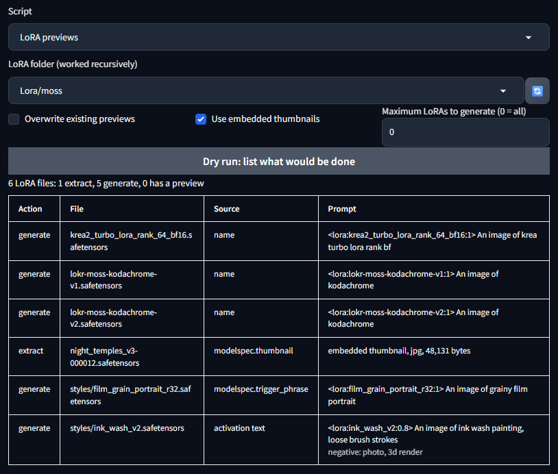
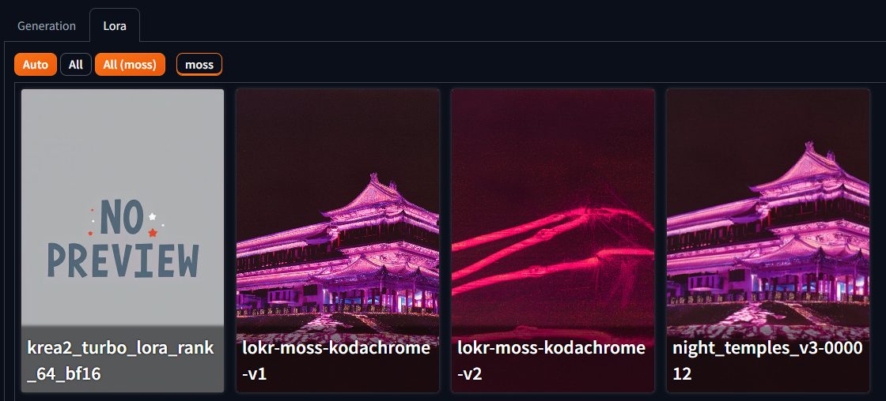

# forge-neo-previews

A Forge Neo extension that gives your LoRAs preview images. For every LoRA in a folder that has no preview yet, it saves the thumbnail the file already carries, or it generates a preview with the model you have loaded and your current txt2img settings.



## The problem

Many LoRAs, most of all those downloaded from Hugging Face, come without a preview image. The Civitai extensions cannot fetch one when the LoRA is not listed on civitai.com, so the Lora page fills up with "No preview" cards.

Making the previews by hand means one generation per LoRA, then "Replace preview" in the metadata editor, one card at a time.

## What the extension does

It adds "LoRA previews" to the txt2img **Script** dropdown. Choose a folder, press Generate, and it works through the folder and its subfolders. For each LoRA:

1. **It already has a preview:** left alone.
2. **The file carries a thumbnail** (`modelspec.thumbnail`, written by some trainers): the thumbnail is saved as the preview, in its original size and format. Nothing is generated. Forge Neo does not show these thumbnails on its own.
3. **Otherwise:** one image is generated with the LoRA applied and saved as `<name>.preview.png`, with the generation parameters embedded like any other output.



After a run on a MOSS-Image model: two kodachrome LoRAs got a generated preview, one LoRA got the thumbnail it carried, and a Krea 2 LoRA did not fit the MOSS model, so nothing was saved for it.

## Install

In Forge Neo: Extensions, Install from URL:

```text
https://github.com/aoleg/forge-neo-previews
```

Then restart Forge Neo.

It needs Forge Neo, the `neo` branch of [sd-webui-forge-classic](https://github.com/Haoming02/sd-webui-forge-classic), and was written against commit `398279f`. It has no dependencies of its own.

## Use

1. Load the model the LoRAs are for, and set up txt2img the way you want the previews: resolution, sampler, steps, CFG, and any scripts or extensions you use.
2. In the **Script** dropdown, choose **LoRA previews**. (With sd-webui-tabs-extension installed, the dropdown is behind the "Scripts" button below the generation settings.)
3. Choose the **LoRA folder**. The list holds every folder that has a LoRA in it or below it.
4. Press **Dry run** to see what would be done for each file, with the prompt it would use.
5. Press **Generate**.
6. Press Refresh on the Lora page to see the new previews.

Only the LoRAs for the loaded model can be applied, so choose a folder that holds LoRAs for that model. A LoRA for another architecture is caught and skipped, see below.

### What is generated

Each preview is one image made with your current txt2img settings, with these changes:

- the prompt and negative prompt are the LoRA's own (see below), and prompt styles are not applied;
- hires fix is off;
- batch size and batch count are 1;
- every preview in a run uses the same seed, so they can be compared. With seed -1, one random seed is picked for the whole run.

Everything else, always-on scripts included, applies as set. The previews are shown in the gallery when the run ends, and the info box lists what was done.

The time per preview is the time of one generation with your settings. With a few-step model or LoRA it takes seconds.

## The prompt

The first of these that the LoRA has gives the prompt:

| Source | Where it comes from | Prompt (default template) |
|---|---|---|
| Activation text | Forge's own metadata for the LoRA (the `.json` file next to it, edited with the card's metadata button) | `An image of {trigger}` |
| Trained words | `<name>.civitai.info`, written by the Civitai extensions | `An image of {trigger}` |
| Trigger in the file | `modelspec.trigger_phrase`, or `trigger_word`, `trigger_words`, `trigger_phrase`, `trigger` in the file's metadata | `An image of {trigger}` |
| Training tags | The most frequent tag of a Kohya LoRA (`ss_tag_frequency`) | `An image of {trigger}` |
| Sample prompt | `modelspec.description`, when it reads like a prompt | `{sample}` |
| File name | The file name without numbers, versions and common words | `An image of {name}` |

The LoRA is added in front, as the card would add it: `<lora:name:weight>`. The weight is the LoRA's "preferred weight", or the default multiplier from the settings. The negative prompt is the LoRA's own "negative text", or the negative template.

Many LoRAs from Hugging Face carry no trigger at all, so the file name is the common case. `lokr-moss-kodachrome-v1.safetensors` gives "An image of kodachrome": the words `lokr` and `moss` are on the list of common words, and `v1` is a version.

A file name often names a style, not a subject, and "An image of kodachrome" leaves the model guessing what to show. A template with a subject usually gives better previews, for example:

```text
A street photograph of a woman at a café table, {name}
```

Every template can use `{trigger}`, `{sample}` and `{name}`. Braces that are not one of these three are left as they are.

## A LoRA for another model

Forge Neo applies a LoRA of the wrong architecture without an error: it logs a warning and makes the image without the LoRA. Saved as a preview, that image would only show what the base model does.

During a run the extension checks whether each LoRA actually changed the model. If it did not, sampling stops after the first step, nothing is saved, and the summary lists the LoRA as "did not fit the loaded model". A LoRA that Forge cannot read at all is listed with Forge's own error.

## Stop, skip, start again

- **Skip** skips the current LoRA. Nothing is saved for it.
- **Interrupt** stops the run at once. Nothing is saved for the current LoRA.
- With Forge Neo's setting "Don't Interrupt in the middle" on, the first press of Interrupt lets the current preview finish and saves it, then stops. A second press stops at once.

A preview is written only when its image is complete. Start the run again and it carries on with the LoRAs that still have no preview. Set **Maximum LoRAs to generate** to do a large folder in parts.

## Existing previews

A LoRA has a preview when Forge Neo would show one: a file named `<name>.<ext>` or `<name>.preview.<ext>` (png, jpg, jpeg, webp, jxl, avif, heif, gif, mp4, webm) next to it, or a cover image inside the file.

They are never replaced unless **Overwrite existing previews** is ticked. With it ticked, an older preview that Forge Neo would show in front of the new one, such as `<name>.png` next to a new `<name>.preview.png`, is renamed to `<name>.png.old`.

## Hidden folders

Folders whose name starts with a dot are skipped when the extension works through a folder. To do the LoRAs in a hidden folder, choose that folder itself. Hidden folders are in the folder list when Forge Neo's setting "List the models/files under hidden directories" is on.

## Settings

Under Settings, LoRA Previews:

- **Prompt when a trigger is found**, **Prompt when the file carries a sample prompt**, **Prompt when nothing else is found**: the three templates.
- **Negative prompt**: used when the LoRA's metadata has none.
- **Words dropped from file names**: the list of common words. Add the words your file names use, such as a trainer's name.
- **Also save generated previews to the outputs folder**: off by default.

## Without Forge

The extension holds a command-line version of the dry run. It needs Python 3.10 or later and nothing else. Run it from the extension's folder:

```text
python -m neo_previews <LoRA folder>
```

It lists what would be done for each LoRA and the prompt it would use. Add `--extract` to save the thumbnails the files carry, which needs no model. `--help` lists the other options.

## License

GPL-3.0. See [LICENSE](LICENSE).
